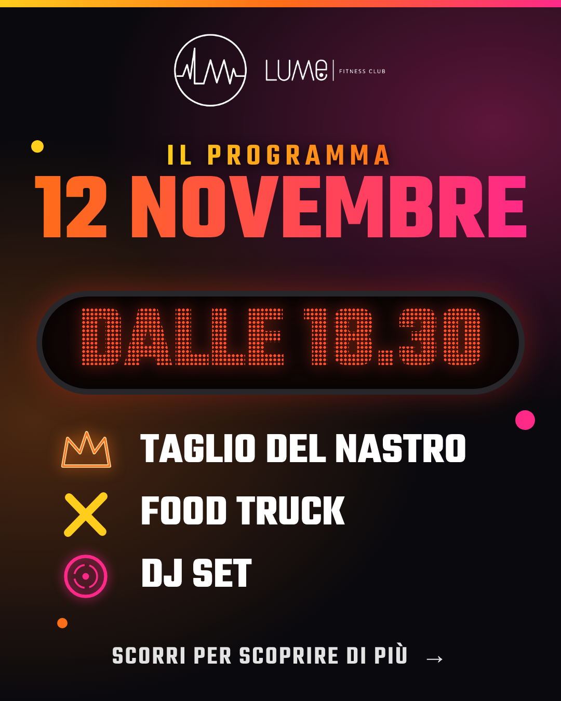
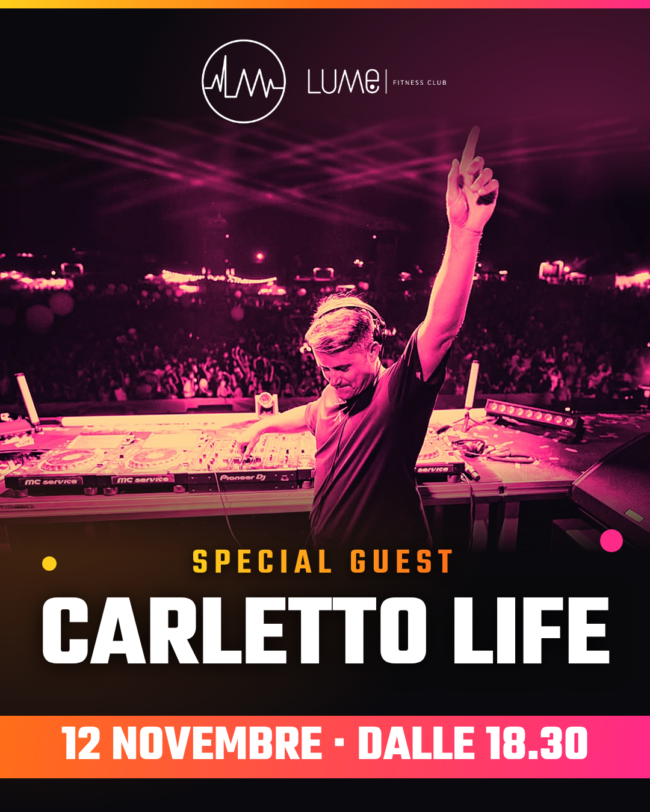
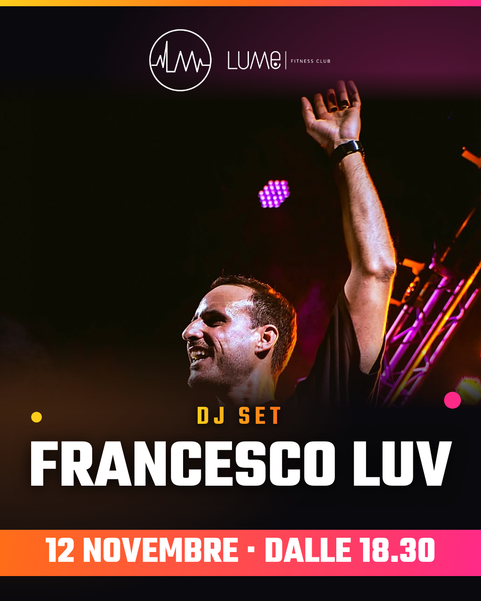
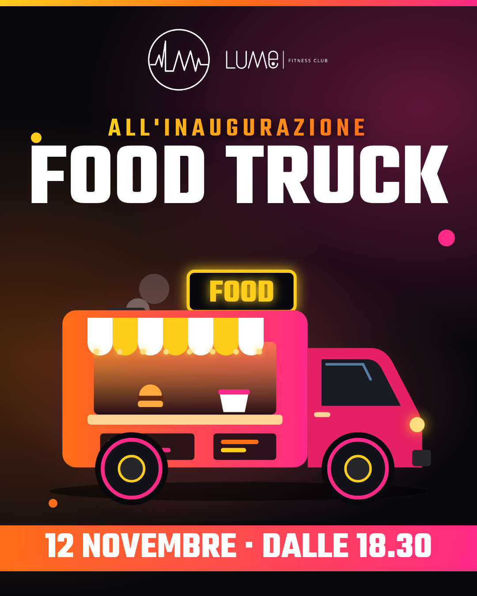
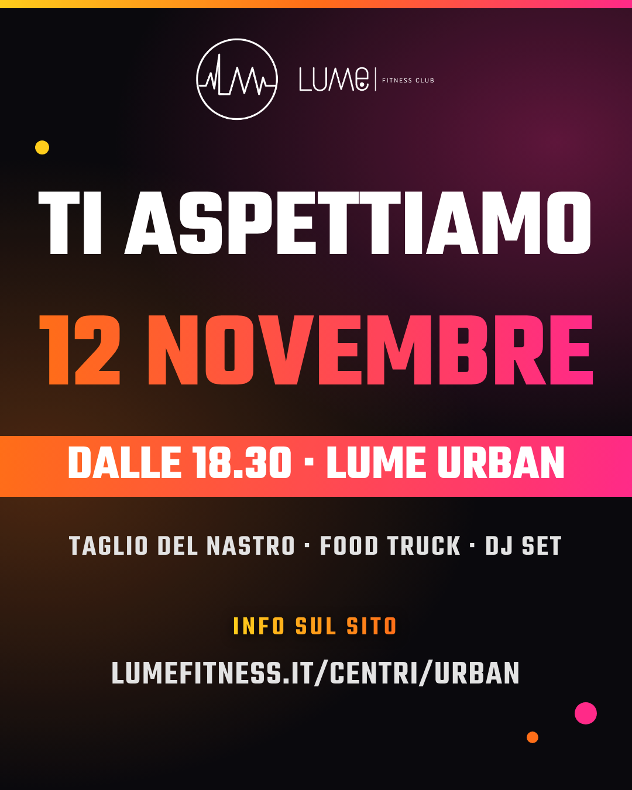
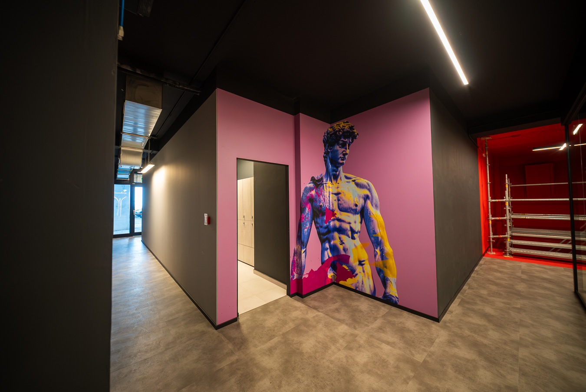
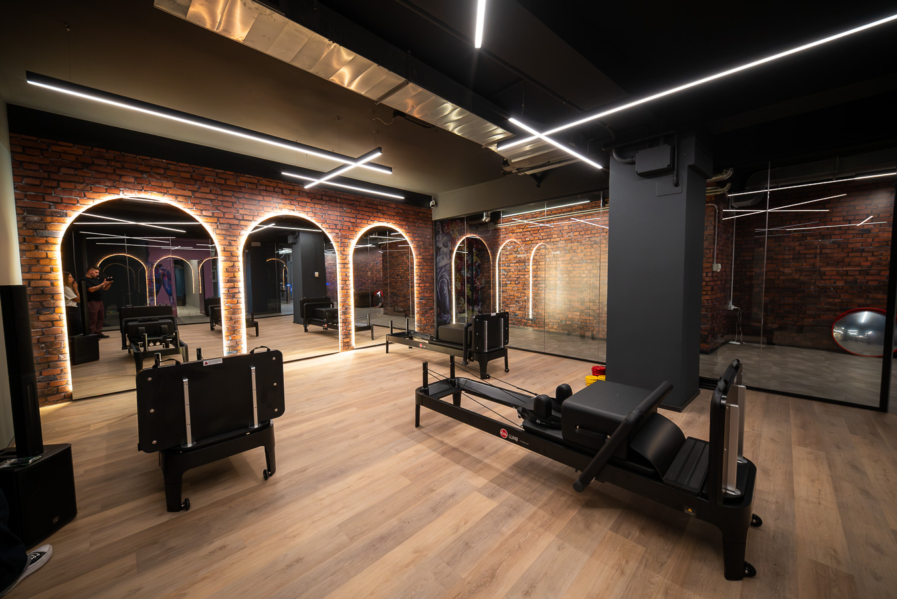
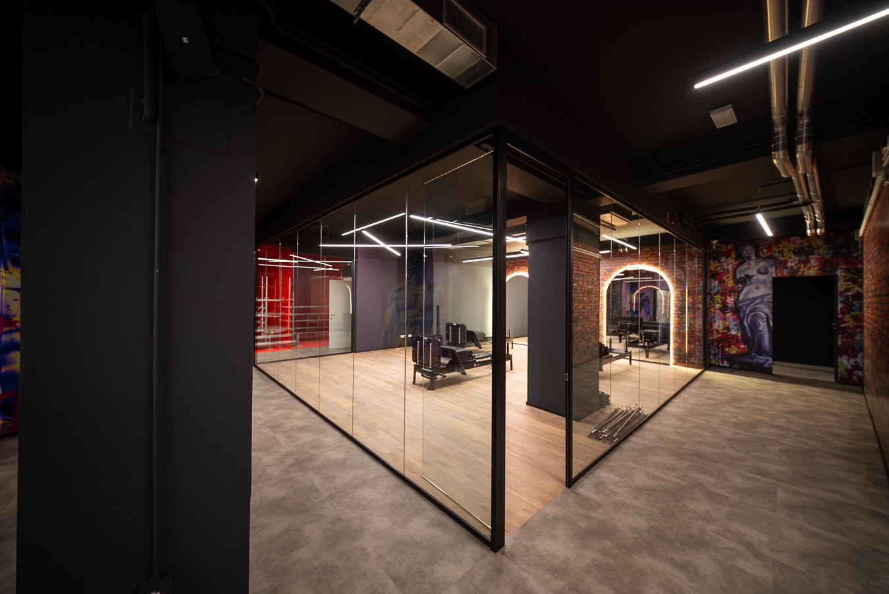

Giovedì **12 novembre**, dalle **18:30**, Lume Urban apre le porte per la serata
di inaugurazione: **1000 mq su due livelli** nel cuore di Macerata, in viale
Leopardi 91. Una sera per girare il club prima di tutti, conoscere il team e
fare festa con noi.

## La serata

Dalle 18:30

<ul class="ev-neon-lista">
<li>Special guest<b>Carletto Life</b></li>
<li>DJ set<b>Francesco Luv</b></li>
<li>All'inaugurazione<b>Food truck</b></li>
<li>Il momento ufficiale<b>Taglio del nastro</b></li>
</ul>

Musica, cena e festa per tutta la sera: il **dj set** di Francesco Luv, lo
**special guest** Carletto Life, il **food truck** per cenare con noi e il
**taglio del nastro**.

## Dentro Lume Urban

Un club pensato per chi si allena sul serio, senza complicazioni. Mattoni a
vista, luci a led, murales e due livelli da girare con calma.

La **sala pesi** è su oltre 520 mq con la linea Panatta Monolith, più l'area
functional con rig, pesi liberi e rack. Per chi preferisce i corsi, c'è la sala
con il programma live e i corsi on demand.

## Vieni a vedere

Vieni a vedere la sala, conoscere il team e scoprire come ci si allena a Lume
Urban. Per qualsiasi domanda sulla serata scrivici con il pulsante qui sotto.
